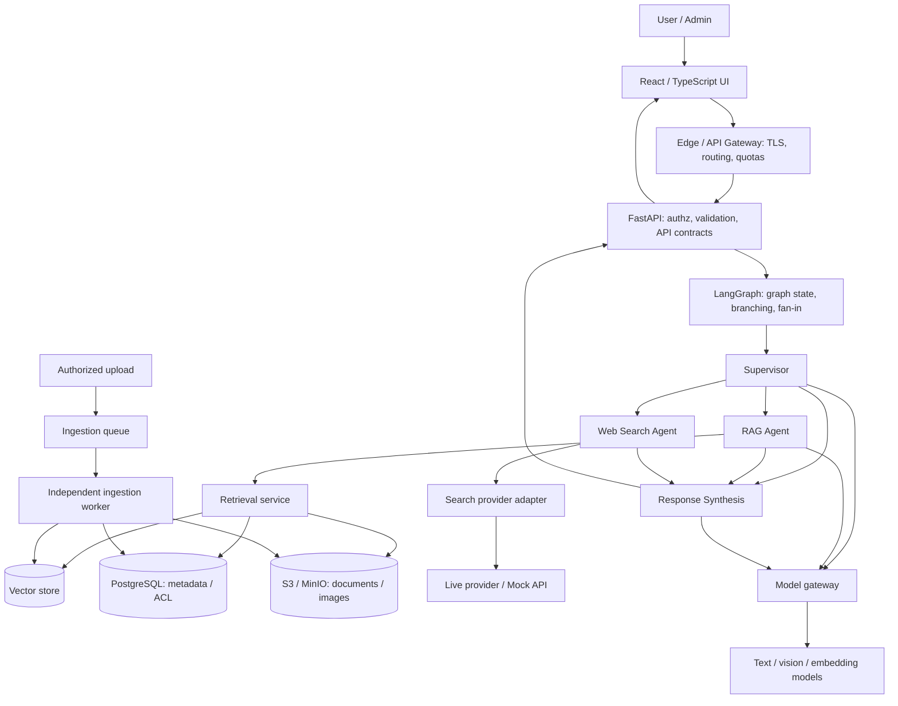
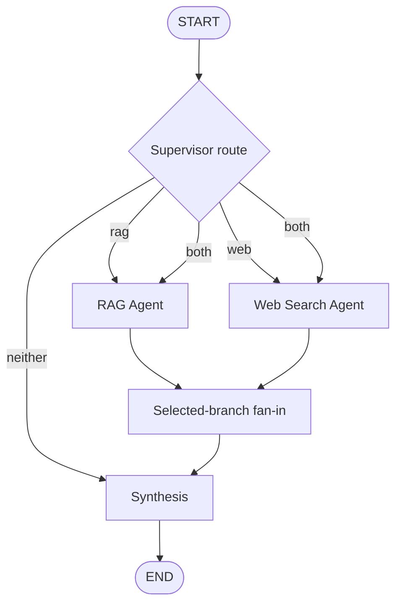

# Multi-Agent Multimodal Research Assistant — Architecture Reference

> **Status:** Target architecture / proposed baseline, **not** proof of production readiness.  
> **Version:** 1.0 | **Date:** 2026-11-19  
> **Source of truth:** Repository `README.md`, `CONTENT.md`, `ACCEPTANCE_CRITERIA.md`. This reference explains their architecture and does not supersede approved requirements.

## 1. Purpose and mandatory scope

Build a graph-orchestrated research assistant with four logical components:

1. **Supervisor Agent:** route each query to `rag`, `web`, `both`, or `neither`.
2. **Multimodal RAG Agent:** retrieve text and images from an authorized supplied corpus, with resolvable source references.
3. **Web Search Agent:** retrieve external evidence through a supplied live web-search tool or deterministic mock API.
4. **Response Synthesis:** combine evidence, deduplicate, distinguish internal/external provenance, and produce a grounded answer.

The four components are **logical LangGraph nodes**, not necessarily four separately deployed microservices. AWS AI-DLC is a **development/release governance harness**, not the application runtime orchestrator.

## 2. System context



### Component ownership

| Component | Owns | Does **not** own | Deployment recommendation |
|---|---|---|---|
| Edge/API gateway | TLS termination, HTTP ingress, throttling | Agent selection | Managed gateway / load balancer |
| FastAPI | Request schemas, identity context, authorization, response contracts | Graph decisions | Research API container |
| LangGraph | Routing, graph state, parallel branches, fan-in, bounded execution | Public HTTP gateway, vector storage | Same API container initially |
| Supervisor | Structured `rag/web/both/neither` decision | Corpus indexing | LangGraph node |
| RAG Agent | Authorized text/image retrieval, internal evidence | Upload processing | LangGraph node calling retrieval module |
| Web Agent | External query and normalized evidence | Internal document retrieval | LangGraph node calling provider adapter |
| Synthesis | Evidence reconciliation, deduplication, provenance and answer | Inventing missing sources | LangGraph node |
| Ingestion worker | File validation, extraction, chunking, embeddings, version publication | User-facing research | Independent worker container |
| Model gateway | Model selection, inference limits, timeout/fallback, telemetry | HTTP ingress or ACL policy | Internal module initially |
| PostgreSQL | Document versions, ACL, jobs, citation metadata | Raw file storage | Persistent managed DB |
| Object store | Originals and extracted images | Search ranking | S3 / MinIO |
| Vector store | Text/image embeddings and filtered search | Source of truth for ACL | Chroma local; Qdrant/pgvector production candidates |

## 3. LangGraph execution contract



**Execution rules**
- `rag`: call only RAG; `web`: call only web; `both`: run both concurrently; `neither`: invoke neither retrieval agent.
- Synthesis executes **exactly once**, after all selected branches succeed or terminate with a bounded error.
- Each parallel node writes a distinct state field (`internal_evidence` versus `external_evidence`); use explicit reducers only for shared append-only fields.
- Preserve `request_id`, `trace_id`, tenant/principal, route, source manifest, branch errors, and model usage.
- Timeout, cancellation, retries and checkpoints must be defined and tested before production.
- An unavailable tool returns an explicit error/empty evidence, **never fabricated results**.

Suggested graph state:

```python
class ResearchState(TypedDict):
    request_id: str
    trace_id: str
    tenant_id: str
    principal_id: str
    query: str
    route: Literal["rag", "web", "both", "neither"]
    internal_evidence: list[dict]
    external_evidence: list[dict]
    errors: list[dict]
    answer: str
    citations: list[dict]
```

Treat this as an illustrative interface, not an assertion about current source code.

## 4. Multimodal RAG architecture

### Offline ingestion (independent of request graph)

`Authorized upload → validate file/type/size and malware → object storage → queued job → text/image extraction → page-aware chunking → text embeddings + image embeddings/captions → tenant/ACL metadata → vector upsert → atomically publish indexed document version`.

- Target source formats: PDF, DOCX, TXT, MD, PNG, JPEG, WEBP; confirm additional formats before committing.
- Maintain document ID, version/checksum, page, chunk/image ID, offsets, storage URI, tenant, and ACL.
- Make ingestion idempotent by document version/checksum; quarantine failed jobs; do not expose partial indexes.
- Image retrieval (e.g. CLIP) is **not** visual interpretation. Use a vision-capable model when an answer requires describing image content.

### Online retrieval

`RAG node → authorize corpus scope → query embedding → ACL-filtered hybrid text/image retrieval → optional rerank → fetch authorized snippets/images → vision analysis if required → structured evidence`.

Never promote document text, image captions, or external pages into trusted system instructions. Enforce authorization at retrieval and source-fetch time, not only in the UI.

## 5. External web search

Adapter contract: `search(query, max_results, timeout) -> SearchResult[]`.

Normalize URL, title, snippet, provider, retrieved-at time, and publication time **only when known**. Provide a deterministic mock for CI. Production adapter must handle timeouts, malformed responses, 429/5xx, bounded retries, outbound URL/SSRF controls, and provider quotas. No configured provider means **no external results**, not simulated web evidence.

## 6. Response synthesis and citations

- Deduplicate using canonical source IDs and normalized content; **retain** distinct internal/external provenance.
- Cite evidence-dependent claims using returned source IDs only.
- Internal citation: `document_id`, `version`, `page`, `chunk_id` or `image_id`.
- External citation: canonical `url`, title/snippet and available timestamps.
- Identify conflicts, missing evidence, and partial branch failures.
- For `neither`, answer general questions or request clarification without inventing retrieved citations.

## 7. API contract (target, not current implementation)

| Endpoint | Purpose |
|---|---|
| `POST /v1/documents` | Authenticated upload; return document/job IDs |
| `GET /v1/ingestion/{job_id}` | Authorized ingestion status |
| `POST /v1/research` | Research request; return route, answer, sources, errors, trace ID |
| `GET /health/live` | Liveness |
| `GET /health/ready` | Dependency readiness |

Example response:

```json
{
  "request_id": "req-123",
  "trace_id": "trace-123",
  "route": "both",
  "answer": "A grounded answer with source citations.",
  "sources": [
    {"origin": "internal", "document_id": "doc-001", "version": "v1", "page": 3, "chunk_id": "c-12"},
    {"origin": "external", "url": "https://example.org/reference"}
  ],
  "errors": []
}
```

**Starter endpoints documented in README:** `POST /ingest`, `POST /research`, `/docs`. Do not mark target `/v1` contracts implemented without inspection and tests.

## 8. Deployment environments

| Environment | Suggested topology | Verification |
|---|---|---|
| Local | Docker Compose: API+LangGraph, worker, Postgres, MinIO, vector store, mock web; Ollama local | Reproducible setup and deterministic tests |
| Staging/UAT | Isolated containers, separate databases/corpus/secrets, controlled live search | E2E, failure injection, security and rollback |
| Production | CDN/UI → API Gateway or ALB → ECS/Fargate API+graph; queue-backed worker; S3; RDS; vector store; external model endpoint | Load, telemetry, recovery, security and approval evidence |

GPU model inference requires a separately suitable GPU deployment or managed model endpoint; do not assume Fargate or Railway provides GPU support. Scale API, workers, retrieval and model serving independently **when measured needs justify it**.

## 9. Security, reliability, observability

**Security:** OIDC/JWT, tenant-aware ACL filtering, least privilege, encryption in transit/at rest, secrets manager, upload validation, SSRF protection, prompt-injection tests, PII-safe logs and audit events.

**Reliability:** bounded provider retries, timeouts, cancellation, queue dead-letter handling, ingestion idempotency, durable graph checkpoints if required, rollback and backups.

**Observability:** end-to-end request trace through API → Supervisor → RAG/Web → Synthesis, with node latency, retrieval scores, provider failures, inference usage, ingestion status, citation validity and error counts. Never log private source contents or secrets by default.

**Non-functional SLOs:** concurrency, p95 latency, uptime, recovery targets and corpus size remain **TBD** pending product-owner decisions and measured tests. Do not present arbitrary targets as achieved.

## 10. Acceptance criteria traceability

| IDs | Required evidence |
|---|---|
| AC-01–04 | Four Supervisor routes; only selected agents called; `both` parallel; synthesis once |
| AC-05–08 | Text/image ingestion, visual understanding or abstention, valid internal source references |
| AC-09–10 | Mock/live web adapter and timeout/429/5xx/malformed payload behavior |
| AC-11–12 | Deduplication, preserved provenance, grounded citations and contradiction handling |
| AC-13–14 | Cross-tenant isolation and prompt-injection resistance |
| AC-15–17 | API contract, bounded fan-in/failure, end-to-end trace |
| AC-18 | Local Compose, staging smoke test and rollback evidence |
| AC-19–20 | Requirement-to-code/test/evidence RTM and authorized human approvals |

**Proposed thresholds, subject to approval:** 100% deterministic citation-reference validity; answer groundedness ≥95% on labeled set; text and image Recall@5 ≥90% separately; all mandatory route/E2E tests pass. These are not verified measurements.

### AI-DLC release gates

| Gate | Evidence |
|---|---|
| G1 | Approved scope, FR/NFR, RTM, acceptance criteria |
| G2 | Reviewed architecture, ADRs, threat model |
| G3 | Reproducible pinned environment |
| G4 | Unit/contract tests and review |
| G5 | Multimodal retrieval and citation evaluations |
| G6 | Search adapter and fault tests |
| G7 | Four routes and graph E2E |
| G8 | Auth, ACL, injection and secret scans |
| G9 | Staging monitoring and rollback |
| G10 | Human UAT and release approval |

**Fail closed:** any mandatory `NOT_RUN`, `NOT_VERIFIED`, `BLOCKED`, or `FAIL` → **NO-GO**. A healthy AI-DLC Doctor result only verifies harness setup, not application readiness.

## 11. Known starter gaps (from repository reference files)

The inspected `README.md` and `CONTENT.md` describe a single-process prototype and explicitly identify these gaps:

- No separate gateway or model gateway implementation.
- CLIP image retrieval exists, but no vision-based image understanding.
- DOCX embedded images are not indexed; chunking, hybrid retrieval, reranking and ACL filtering are absent.
- Web provider is optional; without it, external evidence is empty.
- Authentication, tenant isolation, durable graph checkpoints, background ingestion and production deployment assets are not implemented/verified.
- End-to-end integration and production release evidence remain unverified.

**Do not change these status statements to PASS without repository inspection and executed evidence.**

## 12. Suggested repository organization (target)

```text
README.md
CONTENT.md
ACCEPTANCE_CRITERIA.md
docs/
  architecture/
    ARCHITECTURE_REFERENCE.md      # this document
    adr/                           # architecture decisions
  aidlc/                           # gates, RTM and evidence
apps/
  web/                             # React UI
services/
  research-api/                    # FastAPI + LangGraph nodes
  ingestion-worker/                # background ingestion
packages/
  contracts/                       # API and evidence schemas
  retrieval/                       # text/image retrieval adapters
  providers/                       # web and model adapters
infrastructure/
  local/                           # Compose
  cloud/                           # infrastructure as code
 tests/                             # unit, integration, E2E, evaluation
```

Adapt to actual repository layout; do not reorganize or delete existing files merely to match this illustration.

## 13. Open architecture decisions

1. Single-user demo versus enterprise multi-tenant product?
2. Launch file types, maximum corpus size, image extraction coverage?
3. Live web-search provider, quotas, region and cost?
4. Ollama self-hosted versus hosted model inference; data residency?
5. Expected concurrency, p95 latency, uptime and recovery objectives?
6. Production platform and named approvers for G1–G10?

Record each decision as an ADR, link it to requirements and tests, and obtain approval during **Inception** before Construction.

## 14. Recommended README link

```markdown
## Architecture and acceptance
- [Architecture Reference](docs/architecture/ARCHITECTURE_REFERENCE.md) — ownership, agent graph, RAG, gateways, deployment and acceptance mapping.
- [Component Contracts](CONTENT.md) — target component boundaries and known starter gaps.
- [Acceptance Criteria](ACCEPTANCE_CRITERIA.md) — AC-01–AC-20 and AI-DLC G1–G10.
```
